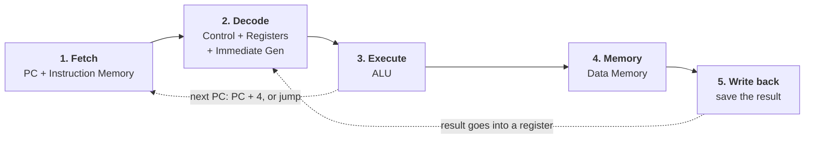
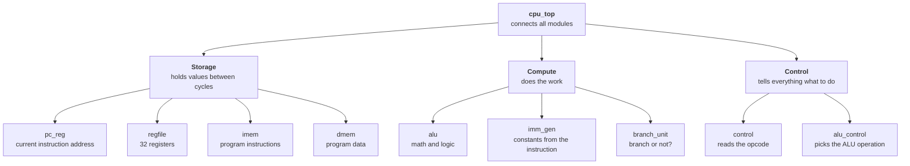

# riscv-single-cycle-cpu

**Software product:** a single-cycle 32-bit RISC-V (RV32I) processor that runs real RISC-V programs in simulation.
**Tech stack:** SystemVerilog, Verilator, C++ testbenches, Make, Surfer/GTKWave, RISC-V GNU toolchain.

## About the Project

This project is a working RISC-V processor built from scratch in SystemVerilog. It runs programs written for the RV32I instruction set, the base version of RISC-V, an open instruction set used in everything from microcontrollers to research chips. Each part of the CPU (the ALU, register file, immediate generator, control unit, and memories) is its own module with its own tests, so anyone can see exactly how a computer turns an instruction into action. The goal is a core that passes all 37 RV32I instructions against the official RISC-V specification, runs small compiled C programs, and is simple enough to read, learn from, and extend.

## User Roles

**Learners** (students studying computer architecture)
- Run a RISC-V program on the CPU and watch every signal change in a waveform viewer
- Read a short, commented module for each CPU part to see how it works
- Compare what each instruction does in the spec with what the hardware does

**Program writers** (people writing RISC-V software)
- Write a RISC-V assembly or C program, compile it to a hex file, and run it on the CPU
- Check the final register and memory values to confirm the program worked

**Hardware developers and researchers**
- Run the full test suite with one command to confirm the CPU is correct
- Extend the core, for example by adding instructions, a pipeline, or an FPGA build
- Use it as a simple, open base for experiments, such as measuring energy or controlling a hardware accelerator

The project is a public code repository with no accounts or user-contributed content, so no permission system is needed.

## Current State (MVP)

The project is in the setup and design phase. No CPU modules are written yet.

- [x] Repository set up with README, MIT license, and `.gitignore`
- [x] CPU architecture planned: module hierarchy and datapath (below)
- [ ] Toolchain installed and verified (Verilator, RISC-V GNU toolchain, Surfer/GTKWave)
- [ ] First module (ALU) written and tested

## Architecture

### How the CPU runs one instruction

A single-cycle CPU does all five steps for one instruction in a single clock tick, then starts the next instruction.



| Step | What happens | Modules |
| --- | --- | --- |
| **1. Fetch** | Read the instruction stored at the address in the PC | `pc_reg`, `imem` |
| **2. Decode** | Figure out what the instruction is and read its input registers | `control`, `regfile`, `imm_gen` |
| **3. Execute** | Do the math, or compare two values for a branch | `alu`, `alu_control`, `branch_unit` |
| **4. Memory** | Loads read from memory; stores write to it (other instructions skip this) | `dmem` |
| **5. Write back** | Save the result into the destination register, then move the PC to the next instruction | `regfile`, `pc_reg` |

**Example:** `add x3, x1, x2` (with `x1 = 5`, `x2 = 7`)

1. **Fetch:** the PC is `0x00`, so read the instruction at address `0x00`.
2. **Decode:** the control unit sees an `add`, and the register file reads `x1 = 5` and `x2 = 7`.
3. **Execute:** the ALU computes `5 + 7 = 12`.
4. **Memory:** skipped, because `add` doesn't use memory.
5. **Write back:** store `12` in `x3` and set the PC to `0x04` for the next instruction.

### Module hierarchy

`cpu_top` connects everything. Each module below is its own file in `rtl/` with its own testbench in `tb/`.



### Planned repo layout

```
riscv-single-cycle-cpu/
├── rtl/        SystemVerilog modules (alu.sv, regfile.sv, ...)
├── tb/         Verilator C++ testbenches, one per module
├── programs/   RISC-V assembly and C test programs
├── docs/       Diagrams, demo notes, waveform screenshots
├── Makefile    make test, make run, make wave
├── README.md
└── LICENSE.md
```

## Roadmap

1. **Setup and design:** repo, toolchain, architecture plan *(current)*
2. **Core modules:** ALU, register file, immediate generator, program counter, each with tests
3. **Control:** main control unit and ALU control
4. **Full datapath:** memories and `cpu_top`; first arithmetic programs running end to end
5. **Full ISA:** loads, stores, branches, and jumps; all 37 RV32I instructions
6. **Verification:** official `riscv-tests` suite and comparison against Spike
7. **Real programs:** small C programs compiled with GCC

## Tech Stack

| Technology | What it's for | Why I chose it |
| --- | --- | --- |
| **SystemVerilog** | Describing the CPU hardware | Industry-standard hardware language; cleaner than plain Verilog (`logic`, `always_ff`, `always_comb`) |
| **Verilator** | Simulating the design | Free, fast, and widely used in industry and open-source RISC-V projects |
| **C++ testbenches** | Feeding inputs and checking outputs | Verilator compiles the design to C++, and I already know C++ from CMPSC 16 and 24 |
| **Make** | Building and running tests | One command (`make test`) runs everything |
| **Surfer / GTKWave** | Viewing waveforms | Free waveform viewers for debugging signal timing |
| **RISC-V GNU toolchain, Venus** | Turning assembly and C into machine code | Produces the programs the CPU runs |
| **Spike** | Reference simulator | Official RISC-V simulator to compare results against |

I may also explore building the same CPU in **PyRTL**, a Python hardware library from UCSB's ArchLab, to compare the two approaches.

## License

[MIT](LICENSE.md)
